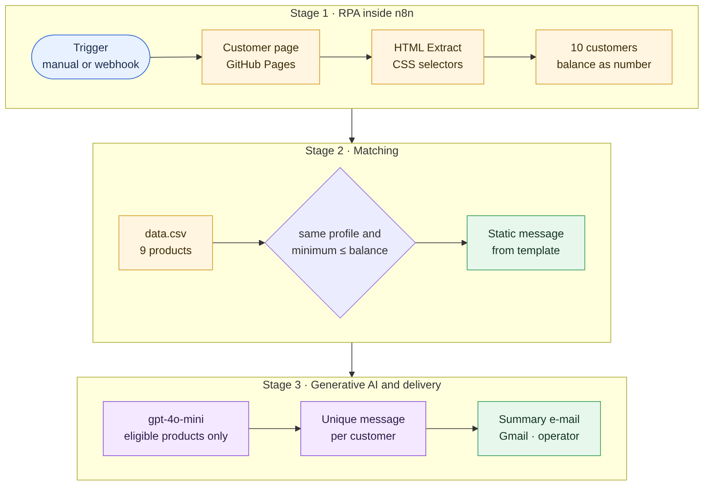
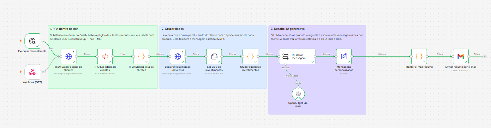
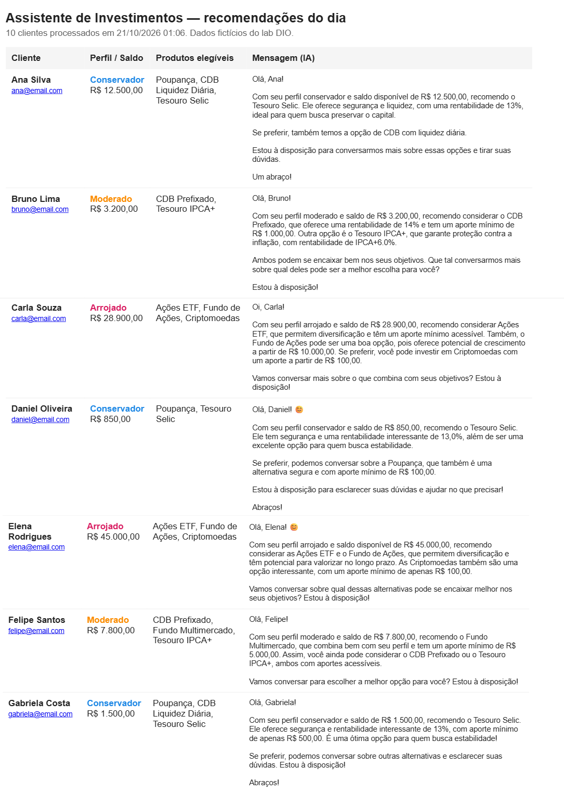

# Investment Assistant · RPA and generative AI in n8n

[Português](README.md) · **English**

> An n8n workflow that collects the customer book from a web page, matches each investor's profile and balance against a product catalog, and delivers, in a single e-mail, a personalized AI-written recommendation for every customer.

     

> Project built for a [DIO](https://www.dio.me/) Project Challenge — *Building an Investment Assistant with RPA and Generative AI*, delivered in the full-challenge version: template-message MVP plus LLM integration.

---

## The problem

Investment advisors need to talk to each customer about products that fit their risk profile and available money. When the customer book lives in a system with no API, someone copies the data by hand, checks the product shelf and writes message after message: repetitive work that can easily recommend the wrong product.

## The solution in one sentence

An RPA robot inside n8n reads the customer table, a code rule picks the products that fit profile and balance, gpt-4o-mini writes the message from those products only, and the operator receives everything in a summary e-mail for review.

## Architecture

Editable diagram source: [`docs/diagramas/arquitetura-en.mmd`](docs/diagramas/arquitetura-en.mmd)

**n8n canvas**

The node-level diagram, generated from the JSON connections, is in [`docs/diagramas-workflows.md`](docs/diagramas-workflows.md).

## Stages and nodes

File: [`workflows/assistente-investimentos.json`](workflows/assistente-investimentos.json) · 13 nodes + 3 notes

| Stage | Nodes | What happens |
|---|---|---|
| Trigger | Executar manualmente · Webhook (GET) | Starts from the editor or from an HTTP call that returns the result as JSON |
| RPA | RPA: Baixar página de clientes → RPA: Ler tabela de clientes → RPA: Montar lista de clientes | Downloads the HTML, extracts the columns with CSS selectors and builds one item per customer, with the balance converted to a number |
| Product catalog | Baixar investimentos (data.csv) → Ler CSV de investimentos | Reads the 9 products with profile, minimum investment and yield |
| Matching | Cruzar clientes x investimentos | Selects same-profile products whose minimum investment fits the balance and builds the template message |
| Generative AI | IA: Gerar mensagem personalizada + OpenAI (gpt-4o-mini) | Writes a unique message per customer using only the eligible products |
| Consolidation | Mensagens personalizadas | Gathers customer, recommended products, template message and AI message |
| Delivery | Montar e-mail resumo → Enviar resumo por e-mail | Builds an HTML table with the 10 customers and sends it to the operator through Gmail |

### Design decisions

- **Native RPA in the orchestrator.** The lab started from a Python notebook with BeautifulSoup. Collection moved into n8n nodes (HTTP Request + HTML Extract with the same selectors), so the whole pipeline runs, schedules and logs in one place.
- **Business rule in code, wording by the AI.** Code decides *what* to recommend (same profile and minimum ≤ balance); the LLM decides *how* to say it. For example, a conservative customer with R$ 850 gets Poupança and Tesouro Selic, and the CDB with a R$ 1,000 minimum stays out.
- **Grounding and compliance in the prompt.** The model receives only the eligible products plus explicit rules: recommend only what is on the list, make no promises about future returns, invent no numbers, and close with an invitation to talk.
- **Template message as a baseline.** The per-profile template is deterministic and free, works as a fallback and sits next to the AI version for comparison.
- **Basic LLM Chain.** The task is writing from ready data, so one direct call per customer, with temperature 0.7 and a token limit, keeps cost and latency predictable.
- **Human in the loop.** The e-mail goes to the operator, with the 10 customers in a table, for review before any customer contact, as the financial sector expects.
- **`executeOnce` on independent sources.** The CSV is downloaded once per run, even though it comes after a node with 10 items.

### Integrations

| Service | Role | n8n node |
|---|---|---|
| GitHub Pages | Customer page and the lab's `data.csv` | HTTP Request, HTML, Extract from File |
| OpenAI | Message writing (gpt-4o-mini) | Basic LLM Chain, OpenAI Chat Model |
| Gmail | Summary e-mail to the operator | Gmail |

## Results

- 10 customers processed per run, with recommendations filtered by profile and balance and two message versions per customer: template and AI.
- One summary e-mail per run, ready for the operator's review:

- Built as the hands-on project of DIO's lab *"Building an Investment Assistant with RPA and Generative AI"*, in the full-challenge version: template-message MVP plus LLM integration.

## How to import

**Requirements:** n8n 2.x (built on self-hosted Community Edition).

1. Under *Workflows → Import from File*, import [`workflows/assistente-investimentos.json`](workflows/assistente-investimentos.json).
2. Create the credentials below and select each one in the matching nodes.
3. Replace the placeholders: `YOUR_EMAIL` in the *Enviar resumo por e-mail* node and `YOUR_WEBHOOK_PATH` in the *Webhook (GET)* node.
4. Click *Execute workflow*, or activate the workflow and call `GET https://<your-n8n>/webhook/<YOUR_WEBHOOK_PATH>`.

| Name in JSON | Type | Setup |
|---|---|---|
| OpenAI API | OpenAI API | OpenAI API key |
| Gmail OAuth2 | Gmail OAuth2 API | Google account authorized to send e-mail |

The customer page and `data.csv` URLs point to the DIO lab's public GitHub Pages and work with no setup.

---

Part of the [n8n Automation Portfolio](../README.en.md) · Juan Antonio Morales, Data Project Manager · [LinkedIn](https://www.linkedin.com/in/juanantoniomorales) · License [MIT](../LICENSE)
