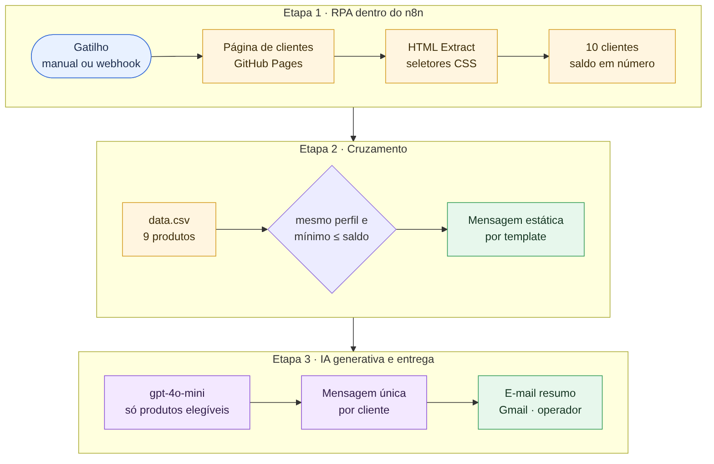

# Assistente de Investimentos · RPA e IA generativa no n8n

**Português** · [English](README.en.md)

> Workflow n8n que coleta a carteira de clientes em uma página web, cruza o perfil e o saldo de cada investidor com uma base de produtos e entrega, num único e-mail, uma recomendação personalizada escrita por IA para cada cliente.

     

---

## O problema

Assessores de investimento precisam falar com cada cliente sobre produtos que façam sentido para o perfil de risco e para o dinheiro disponível. Quando a carteira está num sistema sem API, alguém copia os dados à mão, consulta a prateleira de produtos e escreve mensagem por mensagem, um trabalho repetitivo e sujeito a recomendar o produto errado.

## A solução em uma frase

Um robô de RPA dentro do n8n lê a tabela de clientes, uma regra em código seleciona os produtos compatíveis com perfil e saldo, o gpt-4o-mini redige a mensagem a partir apenas desses produtos e o operador recebe tudo num e-mail resumo para revisar.

## Arquitetura

Fonte editável do diagrama: [`docs/diagramas/arquitetura-pt.mmd`](docs/diagramas/arquitetura-pt.mmd)

**Canvas no n8n**

O diagrama nó a nó, gerado a partir das conexões do JSON, está em [`docs/diagramas-workflows.md`](docs/diagramas-workflows.md).

## Etapas e nós

Arquivo: [`workflows/assistente-investimentos.json`](workflows/assistente-investimentos.json) · 13 nós + 3 notas

| Etapa | Nós | O que acontece |
|---|---|---|
| Gatilho | Executar manualmente · Webhook (GET) | Inicia pelo editor ou por uma chamada HTTP que devolve o resultado em JSON |
| RPA | RPA: Baixar página de clientes → RPA: Ler tabela de clientes → RPA: Montar lista de clientes | Baixa o HTML, extrai as colunas com seletores CSS e monta um item por cliente, com o saldo convertido em número |
| Base de produtos | Baixar investimentos (data.csv) → Ler CSV de investimentos | Lê os 9 produtos com perfil, aporte mínimo e rentabilidade |
| Cruzamento | Cruzar clientes x investimentos | Seleciona os produtos do mesmo perfil cujo aporte mínimo cabe no saldo e gera a mensagem estática por template |
| IA generativa | IA: Gerar mensagem personalizada + OpenAI (gpt-4o-mini) | Escreve uma mensagem única por cliente usando somente os produtos elegíveis |
| Consolidação | Mensagens personalizadas | Reúne cliente, produtos recomendados, mensagem estática e mensagem da IA |
| Entrega | Montar e-mail resumo → Enviar resumo por e-mail | Monta uma tabela HTML com os 10 clientes e envia ao operador pelo Gmail |

### Decisões de design

- **RPA nativo no orquestrador.** O ponto de partida do lab era um notebook Python com BeautifulSoup. A coleta foi levada para nós do n8n (HTTP Request + HTML Extract com os mesmos seletores), e o pipeline inteiro passa a rodar, agendar e registrar logs num único lugar.
- **Regra de negócio em código, redação na IA.** O código decide *o que* recomendar (perfil igual e aporte mínimo ≤ saldo); o LLM decide *como* dizer. Por exemplo, um cliente conservador com R$ 850 recebe Poupança e Tesouro Selic, e o CDB com mínimo de R$ 1.000 fica de fora.
- **Grounding e conformidade no prompt.** O modelo recebe só a lista de produtos elegíveis e regras explícitas: recomendar apenas o que está na lista, não prometer rentabilidade futura, não inventar números e fechar convidando para uma conversa.
- **Mensagem estática como linha de base.** O template por perfil é determinístico e gratuito, serve de fallback e fica ao lado da versão da IA para comparação.
- **Basic LLM Chain.** A tarefa é redação a partir de dados prontos, então uma chamada direta por cliente, com temperatura 0,7 e limite de tokens, mantém custo e latência previsíveis.
- **Humano no circuito.** O e-mail vai para o operador, com os 10 clientes numa tabela, para revisão antes de qualquer contato com cliente, como pede o setor financeiro.
- **`executeOnce` nas fontes independentes.** O CSV é baixado uma vez por execução, mesmo chegando depois de um nó com 10 itens.

### Integrações

| Serviço | Uso | Nó n8n |
|---|---|---|
| GitHub Pages | Página de clientes e `data.csv` do lab | HTTP Request, HTML, Extract from File |
| OpenAI | Redação das mensagens (gpt-4o-mini) | Basic LLM Chain, OpenAI Chat Model |
| Gmail | Envio do e-mail resumo ao operador | Gmail |

## Resultado

- 10 clientes processados por execução, com recomendação filtrada por perfil e saldo e duas versões de mensagem por cliente: template e IA.
- Um e-mail resumo por execução, pronto para revisão do operador:

- Desenvolvido como projeto prático do lab *"Criando um Assistente de Investimentos com RPA e IA Generativa"* da DIO, na versão desafio completo: MVP com mensagens estáticas e integração com LLM.

## Como importar

**Requisitos:** n8n 2.x (construído no Community Edition self-hosted).

1. Em *Workflows → Import from File*, importe [`workflows/assistente-investimentos.json`](workflows/assistente-investimentos.json).
2. Crie as credenciais abaixo e selecione cada uma nos nós correspondentes.
3. Troque os placeholders: `YOUR_EMAIL` no nó *Enviar resumo por e-mail* e `YOUR_WEBHOOK_PATH` no nó *Webhook (GET)*.
4. Clique em *Execute workflow*, ou ative o workflow e chame `GET https://<seu-n8n>/webhook/<YOUR_WEBHOOK_PATH>`.

| Nome no JSON | Tipo | Configuração |
|---|---|---|
| OpenAI API | OpenAI API | Chave da API OpenAI |
| Gmail OAuth2 | Gmail OAuth2 API | Conta Google autorizada a enviar e-mails |

As URLs da página de clientes e do `data.csv` apontam para o GitHub Pages público do lab da DIO e funcionam sem configuração.

---

Parte do [n8n Automation Portfolio](../README.md) · Juan Antonio Morales, Gerente de Projetos de Dados · [LinkedIn](https://www.linkedin.com/in/juanantoniomorales) · Licença [MIT](../LICENSE)
